<div align="center">
  
  <h1>Enjoy 英语练习</h1>
  <p><b>搭一个属于你自己的英语口语练习站:跟读打分、和 AI 对话、背单词,打开手机浏览器就能练。</b></p>
  <p>自建后端 + 手机网页版,一个 Docker 镜像。接你自己的大模型和语音服务,数据留在你自己的服务器上。</p>
</div>

<table align="center">
  <tr>
    <td align="center">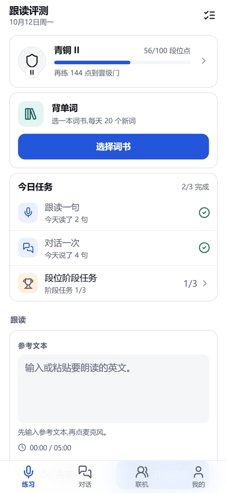</td>
    <td align="center">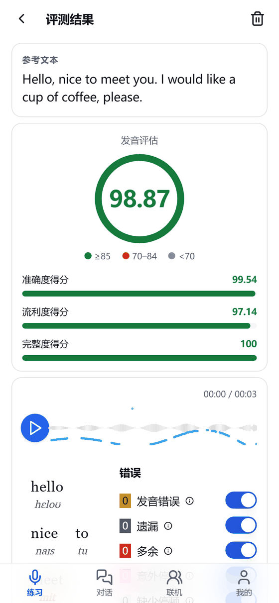</td>
    <td align="center">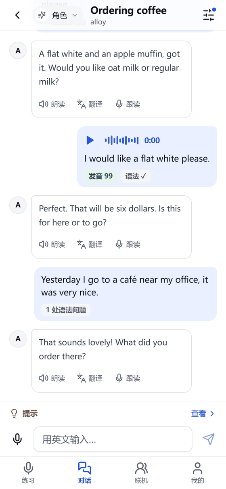</td>
    <td align="center">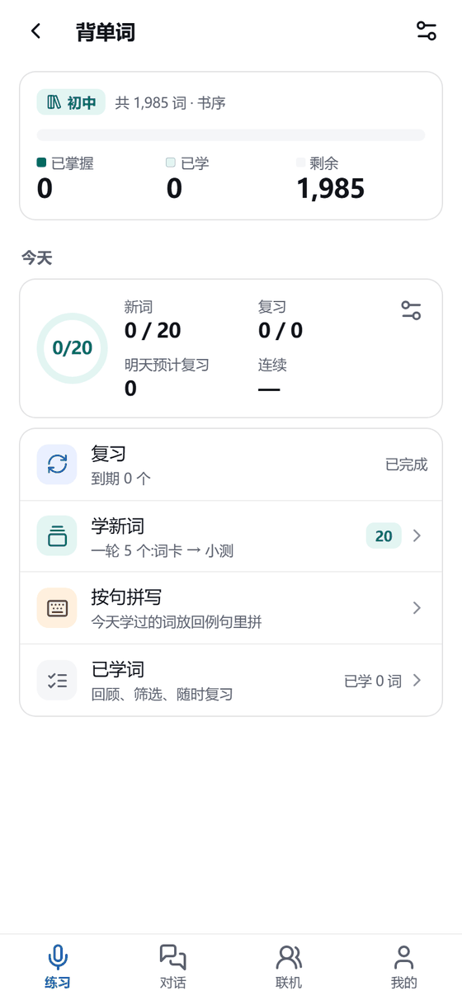</td>
  </tr>
</table>

---

## 这是什么

Enjoy 英语练习是一个可以自己部署的英语口语练习网站。它跑在你自己的服务器上,调用你自己申请的大模型和语音服务,账号、录音和聊天记录都存在你自己的数据库里,不依赖任何第三方账号体系。

界面为手机设计:在手机浏览器里打开,「添加到主屏幕」后像一个 App 一样使用。界面有中文和英文两种,可在「我的」页切换。

本仓库是 [Enjoy](https://github.com/ZuodaoTech/everyone-can-use-english) 的自托管分支,致谢见文末。

---

## 能做什么

> 以下截图来自本地演示环境,账号和数据均为虚构;截图中的 AI 回复由本地模拟服务生成,不代表任何模型的实际表现。

### 跟读与发音评测

输入或粘贴一段英文,可以先听范读,再点麦克风朗读。读完得到总分和准确度、流利度、完整度,每个词都能看到音标与得分,录音可以回放、重录或删除。读过的内容进「练习历史」,想反复练的句子可以收进「练习清单」。

默认可用;评测需要配置讯飞发音评测,范读需要语音合成。

<table>
  <tr>
    <td align="center"><br><sub>练习首页</sub></td>
    <td align="center"><br><sub>评测结果与逐词明细</sub></td>
  </tr>
</table>

### AI 对话

和 AI 用英文聊天,可以自由聊,也可以选咖啡店点单、求职面试、问路等预设场景,或自己写一个场景。每条回复都能朗读、翻译、跟读;卡住时点「提示」看几句能用的话,聊完可以看复盘。

不想打字就切到「按住说话」:按住说,松手发送,上滑可以取消或转成文字。语音消息会附上发音分;你发的英文会被检查语法,点开能看到原句、改正和解释,还能直接跟读改正后的句子。

默认可用;需要大模型,语音消息还需要语音识别和讯飞发音评测,朗读需要语音合成。

**实时通话**:在对话页顶栏点「通话」,边说边聊、可以打断。默认关闭,需设置 `REALTIME_ENABLED=true`,并配好火山语音合成、大模型和语音识别。

<table>
  <tr>
    <td align="center"><br><sub>对话与语音消息</sub></td>
    <td align="center">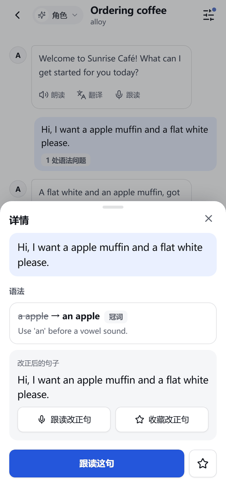<br><sub>语法纠错</sub></td>
    <td align="center">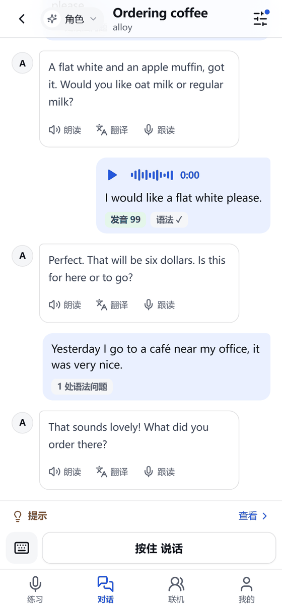<br><sub>按住说话</sub></td>
  </tr>
</table>

### 查词、翻译、词汇本与学习进度

在任何页面选中文字:选几个词就查词(音标、词性、释义、在这句话里的意思),选一整句就翻译,查到的词可以一键加入词汇本。词汇本按间隔复习安排回顾。「学习进度」记录连续天数、说话时长、平均发音分和每日曲线。

默认可用;查词和翻译需要大模型,词汇本和学习进度不调用上游。

<table>
  <tr>
    <td align="center">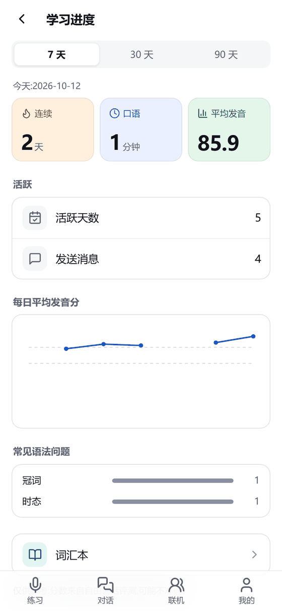<br><sub>学习进度</sub></td>
    <td align="center">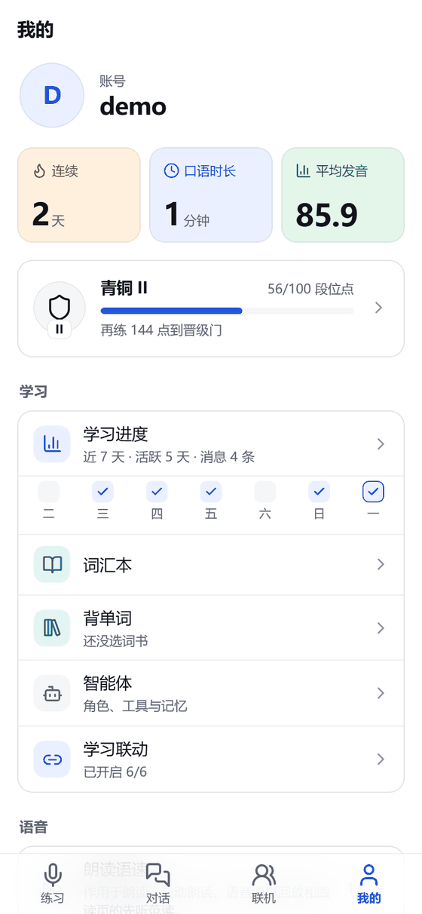<br><sub>「我的」</sub></td>
  </tr>
</table>

### 背单词

选一本词书(初中、高中、四级、六级、考研、托福、SAT),按每日计划学新词、做复习、做例句拼写和单词拼写,学过的词随时回看。判分在服务端完成,不消耗上游额度。

需设置 `WORDBOOK_ENABLED=true`;「为什么」的 AI 讲解另需 `WORDBOOK_AI_ENABLED=true`(用大模型)。

<table>
  <tr>
    <td align="center"><br><sub>背单词首页</sub></td>
    <td align="center">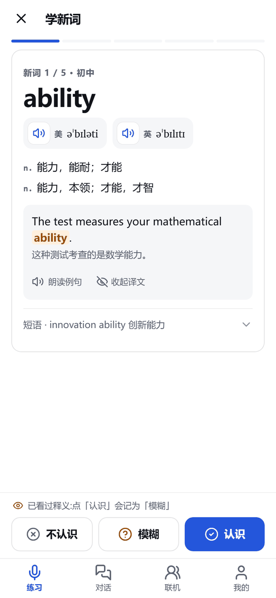<br><sub>学新词</sub></td>
  </tr>
</table>

### 段位赛

练习攒段位点,一级级往上升。有阶段练习、成就墙和赛季;到晋级门槛后参加语音晋级赛,由 AI 考官提问,你用语音作答,限时完成。

需设置 `RANK_ENABLED=true`;晋级赛另需大模型和语音识别,没配时段位点和阶段练习照常可用。

### 联机练习

输入 6 位房间号加入,或自己建一个房间,和朋友在群里用英文聊。`@ai` 提问,回答全员可见;私聊助手帮你组句,只给你自己看。房主可以锁房、关 AI、移人、结束房间,也能发邀请链接和二维码。

需设置 `ROOMS_ENABLED=true`;房间语音消息另需 `ROOMS_VOICE_ENABLED=true`,结束后的 AI 小结另需 `ROOMS_SUMMARY_ENABLED=true`。

<table>
  <tr>
    <td align="center">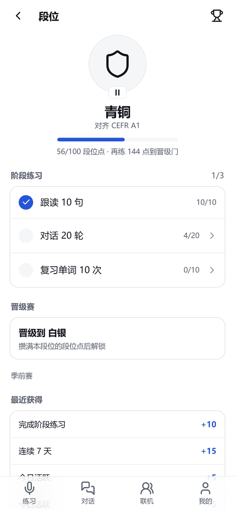<br><sub>段位赛</sub></td>
    <td align="center"><br><sub>联机练习</sub></td>
  </tr>
</table>

### 智能体与「带我学」

在对话和联机里选一个「角色」:内置英语教练和场景角色,也可以自己建。它会参考你学过的词、常错的词来回答,记忆页里能查看、删除它记住的内容。「带我学」导师模式会出题、听你回答、即时点评,最后给总结。

需设置 `AGENTS_ENABLED=true`,并配置大模型。

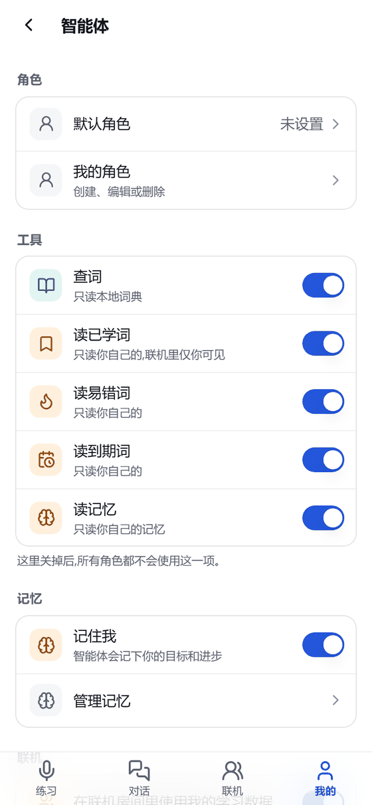

### 学习联动

把各个功能串起来:练习页出现「今日任务」,单词旁多出「加入词书」「跟读」等快捷操作,有易错词和发音弱词专页,对话里用上当天的新词会有提示。每个联动用户都能在「我的」里单独关掉。

需设置 `LINKS_ENABLED=true`;默认不调用上游。

---

## 五分钟部署

需要:一台能跑 Docker 的服务器(Docker Compose ≥ 2.20)、一个域名和 HTTPS 证书、你自己的大模型与语音服务 key。

```bash
cp server/.env.example server/.env
cp docker-compose.example.yml docker-compose.yml     # docker-compose.yml 不进 git,每个部署自己维护
# 编辑 server/.env,填上游配置
docker compose up -d --build                         # 构建镜像,网页版一起打包
docker compose ps                                    # server 应为 healthy
curl localhost:8000/up                               # 返回 {"status":"ok"}
```

服务只监听 `127.0.0.1:8000`,需要在前面放一个反向代理提供 HTTPS。数据默认存在 SQLite(Docker 数据卷 `enjoy-data`),也可以换 Postgres。

### 最少要配什么

| 想用的功能 | 需要哪类服务 | 在 `server/.env` 里填 |
|---|---|---|
| AI 对话、查词翻译、语法检查 | 大模型(OpenAI 兼容的 chat completions) | `UPSTREAM_LLM_BASE_URL`、`UPSTREAM_LLM_KEY`、`LLM_MODELS`、`DEFAULT_LLM_MODEL` |
| 朗读、范读 | 语音合成(三选一) | `UPSTREAM_TTS_BASE_URL` + `UPSTREAM_TTS_KEY`,或 `AZURE_SPEECH_KEY` / `AZURE_SPEECH_REGION`,或 `VOLCENGINE_TTS_KEY`;由 `TTS_MODELS` 列出 |
| 语音消息转写 | 语音识别 | `UPSTREAM_WHISPER_*`,或 `UPSTREAM_WHISPER_MODE=chat`,或 `UPSTREAM_ASR_MODE=volc_stream` |
| 发音评测 | 讯飞发音评测(仅英文) | `XFYUN_APP_ID`、`XFYUN_API_KEY`、`XFYUN_API_SECRET` |
| 实时通话 | 火山语音合成 + 大模型 + 语音识别 | `REALTIME_ENABLED=true` 及以上各项 |

哪一项没配,对应的功能就用不了;其余配置都有默认值。每一项的细节见 [server/README.md](./server/README.md)。

### 创建首批账号

示例配置里 `REGISTRATION_MODE=closed`,没人能注册。先临时改成 `open`(或 `invite` 并设置 `INVITE_CODE`),`docker compose up -d` 重启后在登录页点「注册」建好账号,再改回 `closed` 并重启。

公网上请不要长期开着 `open`:任何人都能注册,消耗的是你的上游额度。

### HTTPS 与反向代理

HTTPS 是必须的:手机浏览器只在安全连接下允许录音,「添加到主屏幕」也需要它。最简单的 Caddy 配置:

```
your.domain { reverse_proxy 127.0.0.1:8000 }
```

用其它反代时请注意:

- `/api/realtime`(实时通话)和 `/api/rooms/ws`(联机)是 WebSocket,要转发 `Upgrade` / `Connection` 头,读超时放宽;
- 请求体上限至少 25m(Nginx:`client_max_body_size 25m;`),录音要上传;
- 反代与服务同机时设 `TRUST_PROXY_HEADERS=true`。

超时、日志脱敏、Postgres、备份、1Panel 等更多说明见 [server/README.md](./server/README.md)。

---

## 功能开关一览

以下默认值以代码为准(`server/app/core/config.py`);唯一例外是注册,表里写的是示例配置的值。背单词、学习联动、智能体几项在 `.env.example` 里是注释状态,需要取消注释再改成 `true`。

| 开关 | 默认 | 打开后 | 上游成本 |
|---|---|---|---|
| `REGISTRATION_MODE` | 示例配置为 `closed`(删掉这一行则为 `open`) | `open` 任何人可注册;`invite` 凭邀请码注册 | `open` 时任何人都能消耗你的额度 |
| `REALTIME_ENABLED` | 关 | 对话页出现「通话」 | 有:语音合成、大模型、语音识别、发音评测 |
| `RANK_ENABLED` | 关 | 段位、阶段练习、成就、晋级赛 | 晋级赛有:大模型、语音识别、发音评测 |
| `ROOMS_ENABLED` | 关 | 「对话」页顶部出现「AI 对话 / 联机」切换 | 有:`@ai` 与私聊助手用大模型 |
| ↳ `ROOMS_VOICE_ENABLED` | 关 | 房间里可发语音消息 | 有:语音识别 |
| ↳ `ROOMS_SUMMARY_ENABLED` | 关 | 房间结束后生成 AI 小结 | 有:大模型 |
| `WORDBOOK_ENABLED` | 关 | 背单词 | 无 |
| ↳ `WORDBOOK_AI_ENABLED` | 关 | 「为什么」AI 讲解 | 有:大模型 |
| `AGENTS_ENABLED` | 关 | 智能体、记忆、「带我学」 | 有:大模型 |
| `LINKS_ENABLED` | 关 | 今日任务、易错词等学习联动 | 默认无 |

改 `.env` 后执行 `docker compose up -d` 重启生效。成本相关的上限与说明见 [server/README.md](./server/README.md)「成本保护」。

---

## 已知限制与未验证

- **真机未验证**:iOS Safari 和安卓 Chrome 上的实时通话、按住说话、联机语音、背单词拼写输入、学习联动面板、智能体记忆页等,目前没有在真机上验证过。
- **反向代理下未实测**:WebSocket(实时通话、联机)在 1Panel / OpenResty / Caddy 后的转发。通话一接通就断开,多半是代理没转发 `Upgrade` 头。
- **只支持单进程**:服务以单 worker 运行,不支持多 worker。
- **费用由你承担**:所有 AI 与语音调用都走你自己的上游并按其计费。见 [server/README.md](./server/README.md)「成本保护」。
- 发音评测必须有参考文本,只支持英文,不给语调分。更完整的清单见 [server/README.md](./server/README.md)「已知限制」。

---

## 文档导航

| 文档 | 内容 |
|---|---|
| [server/README.md](./server/README.md) | 部署、全部配置项、上游接入、成本保护、备份与已知限制 |
| [web/README.md](./web/README.md) | 手机网页版的功能细节、开发与测试 |
| [CLAUDE.md](./CLAUDE.md) | 仓库结构与开发约定 |
| [docs/superpowers/](./docs/superpowers/) | 设计文档与实施计划 |
| [NOTICE](./NOTICE) | 第三方数据(词典)来源与许可 |

### 本地开发

在仓库根目录分别运行:

```bash
yarn web:dev                                     # 网页版,http://localhost:5173,接口代理到 :8000
cd server && uv sync && uv run alembic upgrade head && uv run uvicorn app.main:create_app --factory --port 8000
yarn web:typecheck && yarn web:test              # 网页版检查与测试
cd server && uv run pytest -q                    # 后端测试
```

---

## 致谢与相关阅读

本项目基于 [Enjoy](https://github.com/ZuodaoTech/everyone-can-use-english)(ZuodaoTech/everyone-can-use-english),感谢原作者与所有贡献者。上游的 Enjoy 桌面客户端仍在 `enjoy/` 目录中,也可以指向你的自建后端,见 [server/README.md](./server/README.md)「让客户端指向它」。

### 一千小时(2024)

- [简要说明](https://1000h.org/intro.html)
- [训练任务](https://1000h.org/training-tasks/kick-off.html)
- [语音塑造](https://1000h.org/sounds-of-american-english/0-intro.html)
- [大脑内部](https://1000h.org/in-the-brain/01-inifinite.html)
- [自我训练](https://1000h.org/self-training/00-intro.html)

### 人人都能用英语(2010)

- [简介](./book/README.md)
- [第一章:起点](./book/chapter1.md)
- [第二章:口语](./book/chapter2.md)
- [第三章:语音](./book/chapter3.md)
- [第四章:朗读](./book/chapter4.md)
- [第五章:词典](./book/chapter5.md)
- [第六章:语法](./book/chapter6.md)
- [第七章:精读](./book/chapter7.md)
- [第八章:叮嘱](./book/chapter8.md)
- [后记](./book/end.md)

**许可证**:代码以 [GPL-3.0](./LICENSE) 发布;词典数据为 BSD-3 许可,见 [NOTICE](./NOTICE)。
